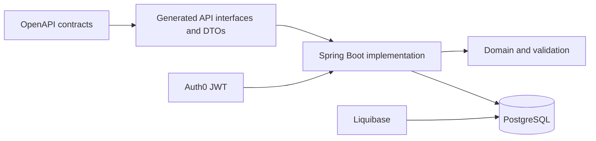

# InsuraHub


> Team project forked from [`cs-pot/insurance`](https://github.com/cs-pot/insurance). The authorship list is preserved below.

InsuraHub is my internship project which I built in Coherent Solutions together with my team (repo was under github of our mentor so I forked it). It's a backend REST API for managing insurance packages, plans, consumers, enrollments, and claims.

The project is built with Java 21 and Spring Boot. It uses an OpenAPI-first approach: API contracts are defined in the `insurahub-api` module, and Java API interfaces/models are generated during the Gradle build.



## Features

- Consumer management
- Insurance package management
- Insurance plan management
- Consumer enrollment into insurance plans
- Claim creation and receipt upload
- JWT authentication with Auth0
- PostgreSQL database integration
- Database migrations with Liquibase
- OpenAPI-based API documentation
- Unit and integration tests

## Tech Stack

- Java 21
- Spring Boot
- Spring Web MVC
- Spring Security
- Spring Data JPA
- PostgreSQL
- Liquibase
- OpenAPI Generator
- MapStruct
- Lombok
- Gradle
- JUnit 5
- Mockito
- Testcontainers

## Getting Started

### Prerequisites

Make sure you have installed:

- Java 21
- Docker
- Docker Compose

### Environment Configuration

Create a `.env` file based on `.env.example`.

Required environment variables include:

```env
DATABASE_URL=jdbc:postgresql://localhost:5433/insurahub
DATABASE_USERNAME=insurahub_user
DATABASE_PASSWORD=insurahub_password

POSTGRES_DB=insurahub
POSTGRES_USER=insurahub_user
POSTGRES_PASSWORD=insurahub_password

AUTH0_ISSUER_URI=
AUTH0_AUDIENCE=
AUTH0_JWK_SET_URI=
AUTH0_DOMAIN=
AUTH0_M2M_CLIENT_ID=
AUTH0_M2M_CLIENT_SECRET=
AUTH0_CONNECTION_NAME=
AUTH0_CONSUMER_ROLE=
AUTH0_ADMIN_ROLE=

SCALAR_CLIENT_ID=
SCALAR_TOKEN_URL=
```

---

## Running the Project

Start PostgreSQL:

```bash
docker compose up postgres
```

Run the Spring Boot application:

```bash
./gradlew :insurahub-implementation:bootRun
```

On Windows:

```bash
gradlew.bat :insurahub-implementation:bootRun
```

The API will be available at:

```text
http://localhost:8080/api/v1
```

---

## Running with Docker

To start the whole application using Docker Compose:

```bash
docker compose up --build
```

---

## Running Tests

Run all tests:

```bash
./gradlew test
```

On Windows:

```bash
gradlew.bat test
```

Run tests only for the implementation module:

```bash
./gradlew :insurahub-implementation:test
```

On Windows:

```bash
gradlew.bat :insurahub-implementation:test
```

---

## API Documentation

The OpenAPI specification is located at:

```text
insurahub-api/openapi/openapi.yaml
```

The API contains endpoints for:

- Authentication
- Consumers
- Insurance packages
- Insurance plans
- Enrollments
- Claims

---

## Authors

- Olaoluwaolive
- Vadym Taraniuk
- Gleb Kasachou
- Salvijus Karnišovas
- Heorhii Lytvynenko
